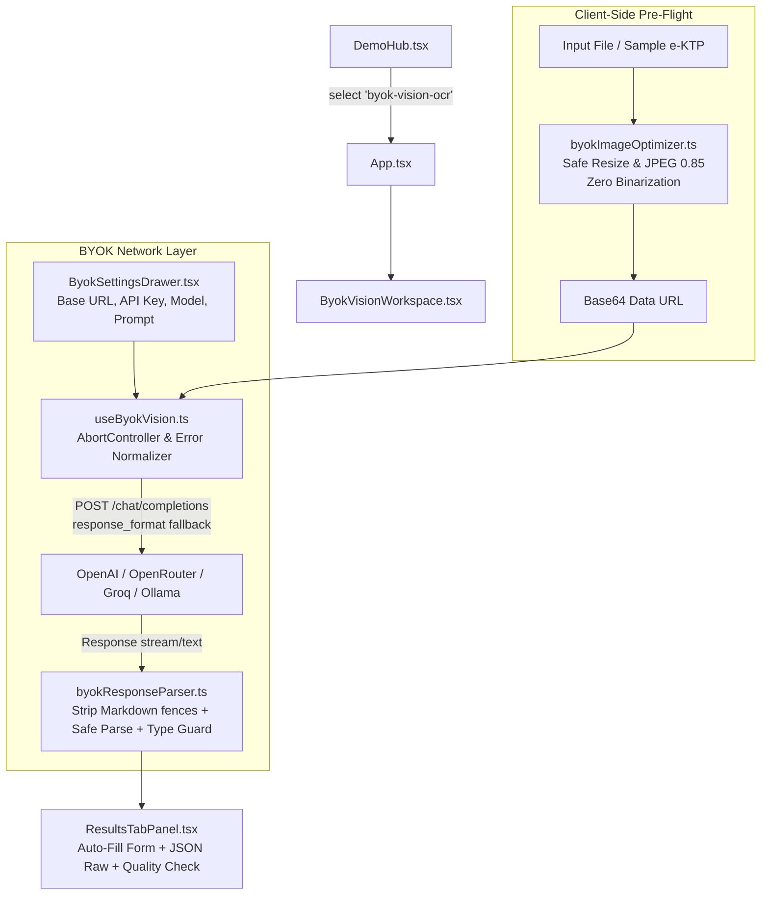

# Implementation Plan: BYOK Vision OCR (OpenAI-Compatible)

**Goal:** Menambahkan versi demo ke-2 ("BYOK Vision OCR (OpenAI-Compatible)") ke dalam `src/demos/registry.ts`, Demo Selector Hub, dan Workspace studio interaktif dengan dukungan endpoint OpenAI-Compatible (OpenAI, OpenRouter, Groq, LiteLLM, Ollama/vLLM, Custom Router) untuk ekstraksi e-KTP presisi tinggi.

---

## Technical Design & Architecture



### 1. Registry & Demo Selection

- `src/demos/registry.ts`: Definisikan interface `DemoVersionItem` dan daftar `DEMO_VERSIONS` (Demo 1: `client-side-tesseract`, Demo 2: `byok-vision-ocr` [v2.0, New, Available], Demo 3: `onnx-web-runtime`, Demo 4: `serverless-hybrid-gateway`).
- Update `src/components/hub/DemoHub.tsx` untuk membaca dari `DEMO_VERSIONS` registry.
- Update `src/App.tsx` untuk me-render `ByokVisionWorkspace` saat `selectedDemoId === 'byok-vision-ocr'`.

### 2. Client-Side Image Pre-Flight (No Binarization)

- `src/utils/byokImageOptimizer.ts`:
  - Resize dengan batas dimensi maksimum 1536px (aspek rasio terjaga).
  - Kompresi `image/jpeg` kualitas 0.85.
  - Mempertahankan warna asli dan konteks spasial tanpa binarization / cyan bleaching.
  - Cleanup canvas width/height = 0 untuk mencegah memory leak.

### 3. Prompt & Defensive Response Parsing

- `src/utils/byokPrompt.ts`:
  - System prompt terstruktur untuk e-KTP Indonesia.
  - Aturan NIK 16 digit, disambiguasi karakter (misal O vs 0, B vs 8).
  - Cross-check NIK tanggal lahir (+40 hari untuk perempuan).
  - Sub-objek alamat (`jalan`, `rt_rw`, `kel_desa`, `kecamatan`).
  - Output JSON format terstandar.
- `src/utils/byokResponseParser.ts`:
  - Tangani wrapping ` ```json ... ``` ` atau teks pengantar/penutup LLM.
  - Ekstrak objek JSON pertama yang valid.
  - Validasi runtime & mapping ke `KtpData` dan `KtpMeta`.
- `src/utils/byokUrlHelper.ts`:
  - Menormalkan base URL: hapus trailing slash, tambahkan `/chat/completions` secara tepat.

### 4. Hook & Network Layer

- `src/hooks/useByokVision.ts`:
  - Parameter: `ByokConfig`.
  - State: `isProcessing`, `error`, `result`, `progressStage`.
  - `AbortController` ref: batalkan request lama saat request baru jalan, saat pengguna klik Cancel, atau saat komponen unmount.
  - Dukungan fallback: Coba kirim `response_format: { type: "json_object" }`, jika provider menolak parameter ini, coba kembali tanpa `response_format`.
  - Error mapping terperinci: 401/403, 404, 429, CORS/Network, Vision unsupported.

### 5. UI Workspace v2 (Compact Above-the-Fold)

- `src/components/workspace/byok/ByokSettingsDrawer.tsx`:
  - Drawer / Modal compact yang elegan.
  - Base URL dengan preset: OpenAI, OpenRouter, Groq, Ollama.
  - API Key password input + show/hide toggle. Opsi simpan ke `sessionStorage`.
  - Model ID dengan preset: `gpt-4o-mini`, `gpt-4o`, `google/gemini-2.5-flash`, `qwen/qwen2.5-vl-72b-instruct`.
  - Temperature terkunci di 0 (deterministik).
  - Tombol & area "Lihat / Edit System Prompt" dengan tombol reset.
- `src/components/workspace/byok/ByokVisionWorkspace.tsx`:
  - Layout 2 kolom compact setara TesseractWorkspace.
  - Header dengan tombol "Kembali ke Demo Hub", status konfigurasi BYOK, dan trigger Settings Drawer.
  - Kolom kiri: File upload / Sample e-KTP, gambar preview asli vs ukuran teroptimasi, tombol Ekstraksi + Cancel.
  - Kolom kanan: Tab Panel (Form Auto-fill, JSON Raw, Quality Check / Vision Raw Output).

---

## Verification Strategy

1. Unit tests:
   - `src/utils/byokUrlHelper.test.ts`
   - `src/utils/byokResponseParser.test.ts`
2. Static checks:
   - `oxlint`
   - `tsc --noEmit`
   - `vitest run`
